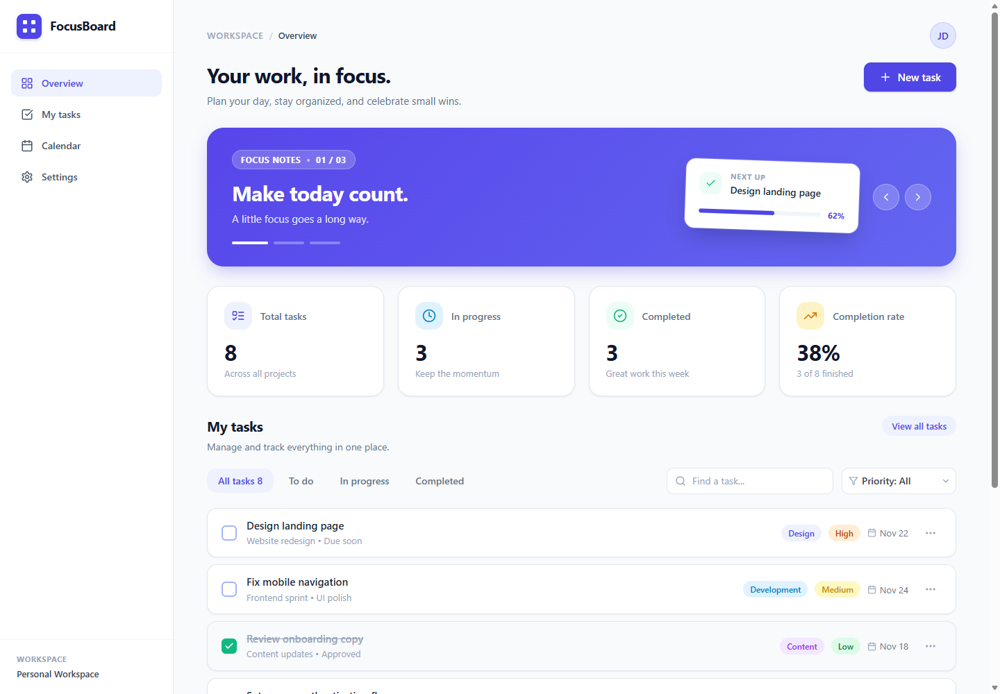
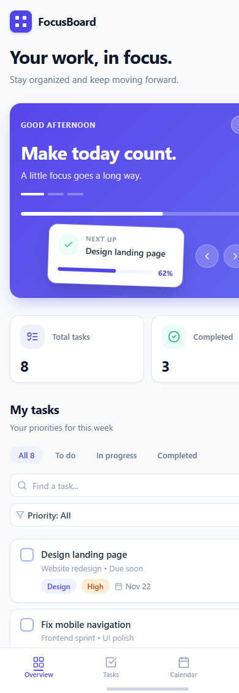

# FocusBoard — Modern Task Management Dashboard

> **Frontend Trainee Assessment** | Built with **React 18 + Vite + JavaScript (ES6+) + Custom CSS3**  
> Faithfully crafted according to the official **FocusBoard Figma Design System**.

---

## 1. Project Overview & Objective

**FocusBoard** is a modern, responsive, high-fidelity task management dashboard engineered to empower individuals and product teams to stay organized, prioritize effectively, and celebrate small wins.

This project was built for the **FocusBoard — Frontend Trainee Assignment (100 Marks)**. It satisfies every requirement outlined in the specification:
- Pixel-perfect reproduction of the official **Desktop Dashboard (1440 × 1000)**, **Mobile Dashboard (390 × 1128)**, and **Create Task Modal (760 × 822)** Figma frames.
- Full client-side CRUD lifecycle (Create, Read, Update, Delete) with interactive status and priority toggles.
- Real-time case-insensitive search and combined multi-criteria filtering.
- Dynamic dashboard statistics and completion rate calculation.
- An interactive **Focus Notes Carousel** featuring all 3 official slides with full keyboard and button navigation.
- Resilient browser persistence via `localStorage` that preserves user modifications while initializing sample tasks safely.

---

## 2. Technologies Used

- **Frontend Framework:** React 18 (Functional components, JSX)
- **Build Tool:** Vite 6 (Lightning-fast HMR and optimized production bundles)
- **Language:** JavaScript (ES6+)
- **Styling:** Custom CSS3 with Design Tokens (CSS Variables, Flexbox, CSS Grid)
- **State Management:** React Context API + `useReducer`
- **Icons:** `lucide-react`
- **Persistence:** Browser `localStorage` API
- **Deployment Platform:** Vercel

---

## 3. Key Features

1. **Dashboard Overview & Statistics:**
   - **Total Tasks:** Real-time count of all tasks across projects.
   - **In Progress:** Dynamic count of tasks actively in flight.
   - **Completed:** Count of completed items.
   - **Completion Rate:** Percentage formula `(Completed / Total) * 100`, with zero-division safety.

2. **Interactive Focus Notes Carousel:**
   - **Slide 1:** *"Make today count."* • *"A little focus goes a long way."* (Preview card: *Design landing page* - 62%).
   - **Slide 2:** *"Small steps, big progress."* • *"Keep your priorities in view."* (Preview card: *Fix navigation* - 67%).
   - **Slide 3:** *"Celebrate the wins."* • *"Every completed task moves you forward."* (Preview card: *Onboarding copy* - 100%).
   - Seamless Previous/Next navigation controls, segmented active-slide indicators, and arrow-key accessibility.

3. **Task CRUD Operations:**
   - **Create Task:** Accessible modal dialog (760 × 822) with validation, required fields, and category support.
   - **Edit Task:** Reusable task form pre-populating existing data without duplicating IDs.
   - **Delete Task:** Destructive action guarded by a custom confirmation dialog.
   - **Inline Status Toggle:** One-click checkbox and dropdown status switches that update statistics and lists instantaneously.

4. **Search and Combined Filtering:**
   - Instant case-insensitive search across task titles, descriptions, and categories.
   - Status tabs: **All tasks**, **To do**, **In progress**, **Completed** with live counter badges.
   - Priority filter: **All**, **High**, **Medium**, **Low**.
   - Derived state architecture ensuring filters work simultaneously without mutating source data.

5. **Visual Quality & Responsiveness:**
   - Verified across desktop (1440px), tablet (768px), and mobile (390px).
   - Desktop sidebar navigation and mobile fixed bottom navigation with iOS home indicator.
   - Custom badges for categories (`Design`, `Development`, `Content`, `Work`) and priorities (`High`, `Medium`, `Low`).

---

## 4. Folder Structure

```
focusboard/
│
├── public/
│   ├── assets/
│   └── favicon.svg              # Custom FocusBoard SVG favicon
│
├── src/
│   ├── assets/                  # Static assets and icons
│   │
│   ├── components/
│   │   ├── Sidebar.jsx          # Desktop left navigation bar
│   │   ├── MobileNavigation.jsx # Mobile fixed bottom navigation
│   │   ├── Header.jsx           # Top breadcrumb, title, and action bar
│   │   ├── DashboardStats.jsx   # Metrics section container
│   │   ├── StatCard.jsx         # Modular stat card component
│   │   ├── FocusNotes.jsx       # 3-slide Focus Notes carousel
│   │   ├── TaskSection.jsx      # Task list container & controls
│   │   ├── TaskItem.jsx         # Task row/card with actions dropdown
│   │   ├── TaskForm.jsx         # Modal form for create & edit
│   │   ├── SearchBar.jsx        # Case-insensitive title search input
│   │   ├── FilterTabs.jsx       # Status filter tab pills
│   │   ├── PriorityFilter.jsx   # Priority select dropdown
│   │   ├── EmptyState.jsx       # Visual empty and zero-result state
│   │   ├── ConfirmDialog.jsx    # Accessible delete confirmation dialog
│   │   └── Toast.jsx            # Action feedback toast notification
│   │
│   ├── context/
│   │   └── TaskContext.jsx      # Single source of truth (Context + useReducer)
│   │
│   ├── hooks/
│   │   └── useLocalStorage.js   # Resilient localStorage synchronization hook
│   │
│   ├── data/
│   │   ├── initialTasks.js      # 8 initial realistic sample tasks
│   │   └── focusNotes.js        # Exact Focus Notes carousel slide data
│   │
│   ├── utils/
│   │   ├── taskHelpers.js       # ID generation, date formatting, filter logic
│   │   └── statistics.js        # Dynamic statistics calculation helpers
│   │
│   ├── styles/
│   │   ├── global.css           # CSS custom properties, resets, typography
│   │   ├── layout.css           # Shell grid, desktop sidebar, main viewport
│   │   ├── components.css       # Cards, banners, buttons, modals, dropdowns
│   │   └── responsive.css       # 1440px, 768px, 390px breakpoint rules
│   │
│   ├── App.jsx                  # Main application orchestrator
│   └── main.jsx                 # React root renderer
│
├── screenshots/
│   ├── desktop.png              # 1440 × 1000 Desktop dashboard screenshot
│   └── mobile.png               # 390 × 1128 Mobile dashboard screenshot
│
├── README.md                    # Project documentation
├── AI_USAGE.md                  # Comprehensive AI usage disclosure
├── vercel.json                  # Vercel deployment configuration
├── vite.config.js               # Vite build configuration
└── package.json                 # Project dependencies & scripts
```

---

## 5. State Management Architecture

The application adopts a **centralized single-source-of-truth** architecture powered by React's **Context API** combined with `useReducer`:

1. **Predictable State Transitions:**
   - `ADD_TASK`: Appends new immutable task records with unique auto-generated IDs.
   - `UPDATE_TASK`: Replaces the matching task by ID while preserving untouched attributes.
   - `DELETE_TASK`: Filters out target task by ID.
   - `UPDATE_TASK_STATUS`: Directly updates task workflow status (`To do`, `In progress`, `Completed`).

2. **Derived Computations Over Duplicate State:**
   - Both **statistics** (`stats`) and **filtered lists** (`filteredTasks`) are computed via `useMemo` from the canonical `tasks` state. This eliminates synchronization bugs, race conditions, and duplicate arrays.

3. **Separation of Concerns:**
   - Filtering, searching, and UI modal states are maintained cleanly within `TaskContext`, exposing clean semantic functions (`openCreateForm`, `openEditForm`, `openDeleteDialog`, `updateTaskStatus`) to consumer components without prop drilling.

---

## 6. LocalStorage Implementation

Browser persistence is handled through a custom `useLocalStorage` hook and `TaskProvider` synchronization:
- **Key:** `focusboard_tasks`
- **Safe Initialization:** The application first inspects `localStorage`. If existing valid records are detected, they are restored immediately.
- **Sample Data Guard:** Initial sample tasks (`INITIAL_TASKS`) are loaded **only** if the storage key is absent or empty. Refreshing the browser or adding new tasks will **never** overwrite user modifications with initial defaults.
- **Corrupted Data Resiliency:** Storage reads are wrapped in `try / catch` blocks to gracefully handle corrupted JSON strings or browser quota exceptions.

---

## 7. Responsive Breakpoints

FocusBoard is built mobile-first and optimized for the assessment's target dimensions:
- **Desktop (1440px):** Full-height fixed sidebar navigation, spacious layout, 4-card statistics row, rich Focus Notes banner with tilted floating card and circular arrow buttons, and wide tabular task rows.
- **Tablet (768px - 1024px):** Fluid sidebar reflow, 2-column statistics grid, responsive filter bar stacking, and readable typography.
- **Mobile (390px):** Faithfully matches the Mobile Figma specification:
  - Collapses desktop sidebar into a mobile header with branding and user avatar (`JD`).
  - Mobile Focus Notes banner with *"GOOD AFTERNOON"*, compact greeting, and linear progress indicator.
  - Overview grid with 2 priority metric cards (`Total tasks` and `Completed`).
  - Mobile task cards with touch-friendly checkboxes and badges.
  - Fixed bottom navigation bar with active indicators and iOS home indicator.

---

## 8. Accessibility Features

- **Semantic Markup:** Built with `<header>`, `<aside>`, `<main>`, `<section>`, `<article>`, and `<nav>` elements.
- **Button Standards:** All interactive items use genuine `<button>` elements with clear `aria-label` attributes where text is omitted.
- **Keyboard Navigation:**
  - Focus Notes carousel supports `ArrowLeft` and `ArrowRight` keyboard traversal.
  - Modals support closing on `Escape` key and click-outside backdrop dismissal.
  - Visible `:focus-visible` focus rings styled in brand purple (`#4F46E5`).
- **Form Accessibility:** All inputs and select controls feature associated `<label>` or `htmlFor` tags and explicit `aria-labelledby` dialog references.

---

## 9. Visual Screenshots

### Desktop Dashboard (1440 × 1000)


### Mobile Dashboard (390 × 1128)


---

## 10. Local Setup & Execution Instructions

### Prerequisites
- **Node.js:** v18.0.0 or higher (v20+ recommended)
- **NPM:** v9.0.0 or higher

### Steps

1. **Clone the repository:**
   ```bash
   git clone https://github.com/manikeshwarlagishetti-coder/focusboard.git
   cd focusboard
   ```

2. **Install dependencies:**
   ```bash
   npm install
   ```

3. **Start the development server:**
   ```bash
   npm run dev
   ```
   Open your browser and navigate to `http://localhost:5173`.

4. **Create a production build:**
   ```bash
   npm run build
   ```

5. **Preview the production build locally:**
   ```bash
   npm run preview
   ```

---

## 11. Live Deployment & Repository Links

- **GitHub Repository:** [https://github.com/manikeshwarlagishetti-coder/focusboard](https://github.com/manikeshwarlagishetti-coder/focusboard)
- **Live Vercel Deployment:** Ready for instant deployment on Vercel (`vercel.json` configured).

---

## 12. Known Limitations & Notes

- **Offline-Only Demonstration:** As specified by the assessment guidelines, no backend, remote database, or third-party task API is used. All persistence is client-side via browser `localStorage`.
- **Navigation Screens:** "Calendar" and "Settings" tabs serve as illustrative workspace navigation items that highlight UI routing states without unnecessary blank routes, matching the assessment scope.
